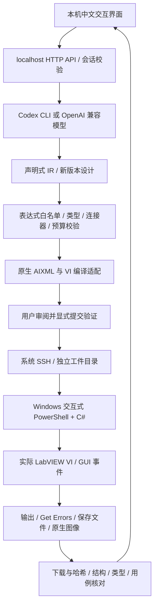

# 架构与执行边界

模型不持有 SSH 凭据或执行器回调。Codex CLI 请求在临时空目录执行，使用只读 sandbox 并关闭该次请求的 Shell／MCP 工具；模型只返回设计，后端选择可信编译器路径。IR 的表达式由专用解析和解释逻辑处理，不通过 `eval` 执行任意 Python。

`vi_service.py` 将设计、父版本、差异、编译及验证结果分别保存。复杂已知 VI 的导入通过已保存二进制哈希匹配原始 IR；它不是任意二进制 VI 的通用逆向编辑器。

UI 程序的事件分支、Timeout 和真实按钮验证由不同层负责。模型给出的预期结果、Python 解释结果、LabVIEW 实际结果必须分开记录。是否创建了 `.vi` 文件，也不能代替原生编译错误检查和运行测试。

原生读写依赖上游 `labview-mcp` 的公开实现和发布工具。此仓库只保留项目适配、IR、执行器及固定辅助源码，第三方软件依赖在本地安装。
